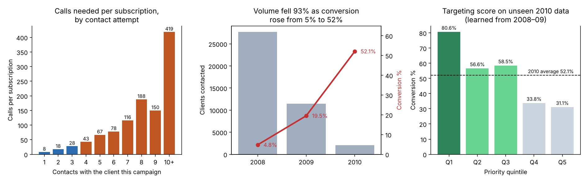
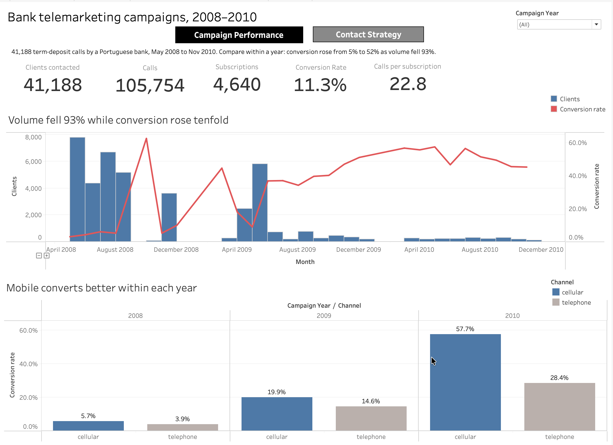
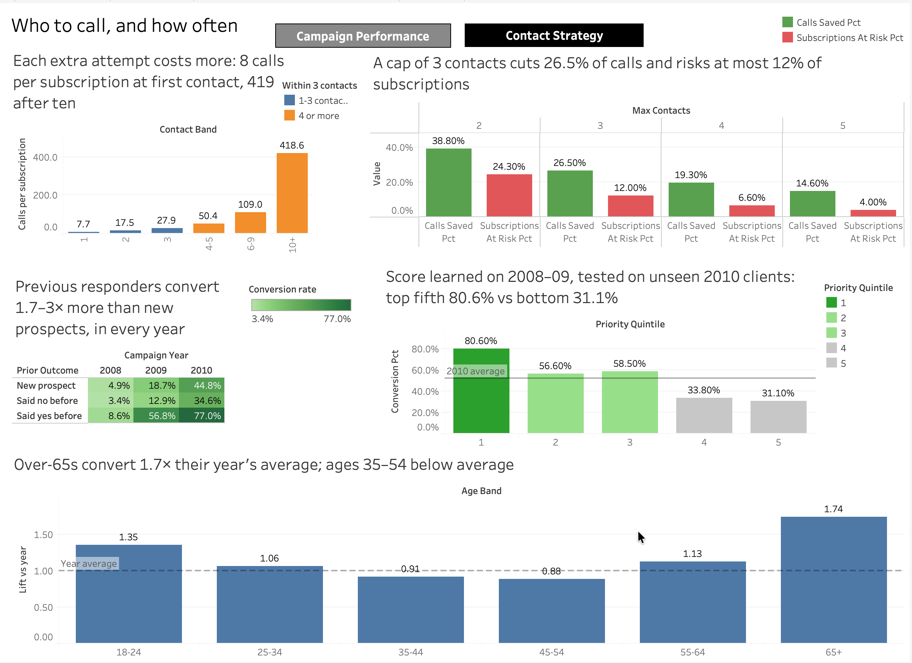

# Bank Marketing Campaign Analysis (SQL)

A SQL-first analysis of a real bank's direct-marketing campaigns: 41,188 client contacts made by a
Portuguese bank between May 2008 and November 2010 to sell a term deposit. The questions are the
ones a marketing or CRM team asks: how hard to push each client, who to call first, which channel
works, and which "obvious" patterns in the data are traps.

All analysis is in plain SQL files run with DuckDB; Python only runs the files, tests them and
exports the dashboard extract. The dashboard is built in Tableau Public.

**Dashboard:** [Bank Marketing Campaign Analysis on Tableau Public](https://public.tableau.com/app/profile/yash.dubey7502/viz/BankMarketingCampaignAnalysis_17956251253340/CampaignPerformance) &nbsp;·&nbsp; **Data:** [UCI Bank Marketing](https://archive.ics.uci.edu/dataset/222/bank+marketing) (Moro, Cortez & Rita, 2014; CC BY 4.0)





## Recommendations

1. **Cap contact attempts at 3.** The first contact costs 7.7 calls per subscription; by the 10th
   attempt it is 419. A cap of 3 would cut **26.5% of calls** and put at most **12% of
   subscriptions** at risk; the calls beyond the cap produced one subscription per 50.5 calls,
   against 22.8 overall.
2. **Call previous responders first.** Clients who said yes to an earlier campaign convert
   **1.7–3.0× more often than new prospects within the same year**. Clients who said no before
   convert *less* often than new prospects (0.7×), so they should not be prioritised just because
   they are known.
3. **Prefer mobile numbers.** Within 2009 and 2010, mobile converted at 19.9% vs 14.6% and 57.7%
   vs 28.4% for landline. The overall gap (14.7% vs 5.2%) overstates it, because early 2008 was
   landline-only.
4. **Rank clients with a simple score before each campaign.** Segment rates learned from 2008–09
   and applied to 2010 put clients in five priority groups: the top fifth converted at **80.6%**,
   the bottom fifth at **31.1%**, and the top two fifths captured **53% of subscriptions**.
5. **Do not plan by calendar month.** March, September, October and December look like the best
   months (44–51% conversion), but they are small months that fall almost entirely in 2009–2010,
   after volume dropped and targeting tightened. Month is standing in for period, not causing
   anything.

## What the data shows

**Everything changed between years, so compare within a year.**

| Year | Clients | Calls | Subscriptions | Conversion | Calls per subscription | Euribor 3m |
| --- | --- | --- | --- | --- | --- | --- |
| 2008 | 27,690 | 77,513 | 1,339 | 4.8% | 57.9 | 4.82% |
| 2009 | 11,440 | 24,320 | 2,228 | 19.5% | 10.9 | 1.23% |
| 2010 | 2,058 | 3,921 | 1,073 | 52.1% | 3.7 | 0.81% |

Volume fell 93% while conversion rose tenfold, alongside the collapse in interest rates after the
2008 financial crisis. The data cannot separate better targeting from the changed economy, so every
comparison below is made within a year or as lift over that year's average.

**Repeat contact has steeply diminishing returns** (`03_contact_frequency.sql`, `04_call_cap_scenarios.sql`)

| Cap on contacts | Calls saved | Subscriptions at risk (upper bound) | Calls per subscription beyond the cap |
| --- | --- | --- | --- |
| 2 | 38.8% | 24.3% | 36.3 |
| **3** | **26.5%** | **12.0%** | **50.5** |
| 4 | 19.3% | 6.6% | 66.7 |
| 5 | 14.6% | 4.0% | 82.9 |

The decline holds within 2009 and 2010 (conversion 20.6% for 1–3 contacts vs 7.9% for 7+ in 2009).
In 2008, when conversion was low for everyone, it was flat.

**Segments** (`08_segments.sql`, lift over the same year's average): clients aged 65+ convert at
1.74× and 18–24 at 1.35×; ages 35–54 are below average (0.88–0.91×).

## Data quality

Checked before analysis (`01_data_quality.sql`):

- 41,188 rows, matching the published count. 12 exact duplicate rows, kept because identical
  records can be genuine.
- **8,597 rows (21%) have an unknown credit-default status.** Kept as their own category: they
  convert at 5.2% vs 12.9% for "no", so treating unknown as "no" would distort any segment.
- **4,110 rows are inconsistent:** they record previous contacts (`previous > 0`) but have
  `pdays = 999`, which is documented as "never contacted". Prior outcome is taken from `poutcome`,
  which agrees with `previous`.
- **The file has no year.** Rows are in date order, so the year is inferred in SQL wherever the
  month number drops (a `LAG` window over row order). The result matches the documented period,
  May 2008 to November 2010, and the known fall in Euribor.
- **Call duration is excluded from all targeting.** It is strongly linked to the outcome but only
  known after the call ends, so using it would be leakage.

## How it is built

```
sql/
  00_load.sql               load the CSV, infer year from row order, build the `contacts` table
  01_data_quality.sql       row count, duplicates, unknowns, inconsistent fields
  02_overview_by_year.sql   volume, conversion, calls per subscription, economic context
  03_contact_frequency.sql  diminishing returns with cumulative window functions
  04_call_cap_scenarios.sql savings and risk for caps of 2 to 5 contacts
  05_prior_outcome.sql      previous outcome as lift over new prospects, within year
  06_channel.sql            mobile vs landline, overall and within year
  07_month_trap.sql         why month-level conversion misleads
  08_segments.sql           age bands as lift over the year average
  09_targeting_score.sql    segment score learned on 2008-09, tested on 2010 by quintile
run_analysis.py             runs every file in order, saves outputs/*.csv and tableau_data/contacts.csv
download_data.py            fetches the dataset from UCI
tests/                      synthetic tests (year inference, cap arithmetic) and real-data checks
docs/tableau_guide.md       step-by-step build of the Tableau dashboard
```

SQL techniques used: CTEs, window functions (`LAG`, running `SUM ... OVER`, `NTILE`), `FILTER`
aggregates, `CROSS JOIN` scenario tables, self-joins for lift, and out-of-time validation.

## Run it

```bash
python -m venv .venv && source .venv/bin/activate
pip install -r requirements.txt
python download_data.py      # saves data/bank-additional-full.csv
python run_analysis.py       # prints every result, writes outputs/ and tableau_data/
pytest -q
```

CI downloads the data, runs the analysis and the tests on every push.

## Limitations

- One bank, one product, 2008–2010. The direction of the findings is more transferable than the
  exact numbers.
- Each row is a client's record for one campaign, not each individual call, so "calls" means the
  number of contacts recorded for that client.
- The call-cap risk is an upper bound: some clients who converted on a later attempt might have
  converted anyway.
- The targeting score is deliberately simple (four inputs, segment averages) so a marketing team
  can see why each client is ranked where they are. A model could rank better; this shows the
  value of ranking at all.
